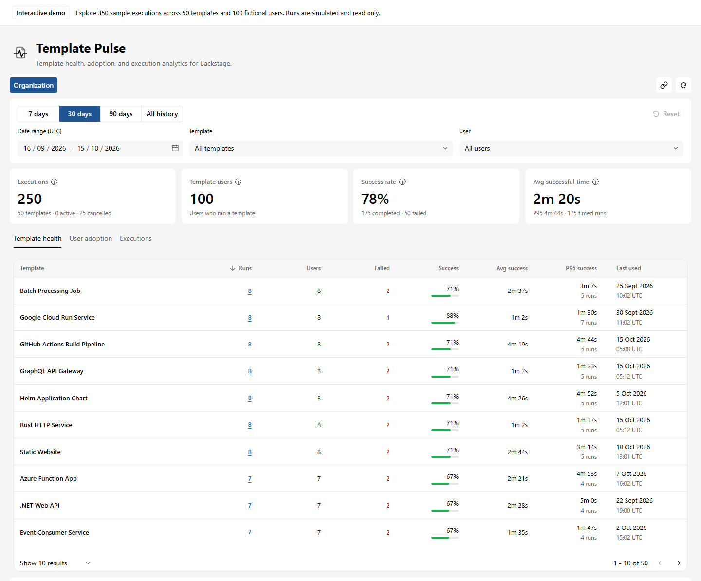
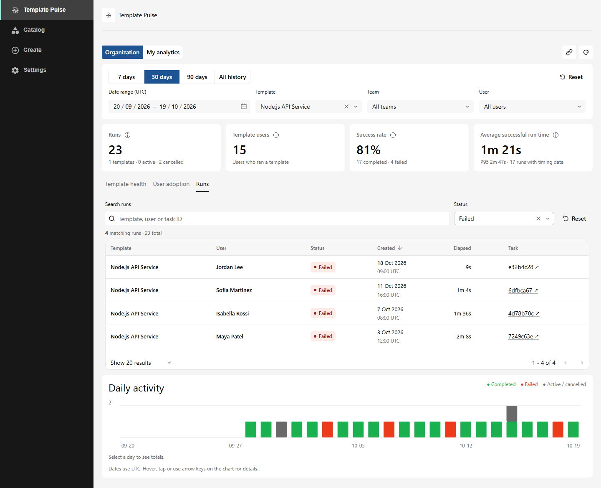
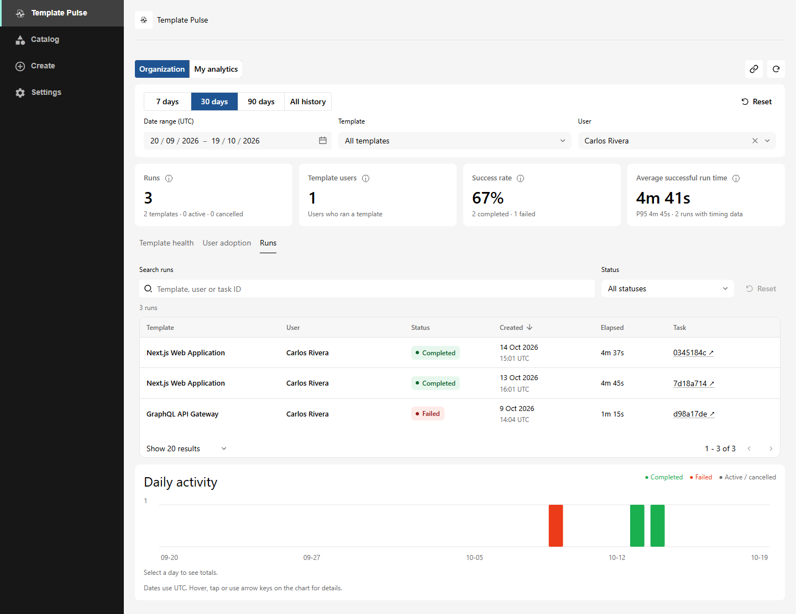

# Template Pulse

**[Try the live demo](https://alibayramli.github.io/template-pulse-demo/)** · [Run the demo locally](https://github.com/alibayramli/template-pulse-demo#run-the-showcase)

<picture>
  <source media="(prefers-color-scheme: dark)" srcset="plugins/template-pulse/assets/template-pulse-wordmark-inverse.svg">
  
</picture>

See which Backstage templates teams use, how often runs succeed, and how long they take. View your own runs or runs across the organization, filter run history, and open the original Scaffolder task for details.

## Preview

Template Pulse inside Backstage, using fictional demo data.



<details>
<summary>Runs by template and user</summary>





</details>

## Add to Backstage

Requires Backstage's new frontend and backend systems, React 18, and Node.js 22 or 24.

The npm preview release is being prepared. Once published, install these packages in your app and backend workspaces:

```sh
yarn workspace app add @abayramli/backstage-plugin-template-pulse@next
yarn workspace backend add @abayramli/backstage-plugin-template-pulse-backend@next @abayramli/backstage-plugin-template-pulse-common@next
```

Add the frontend plugin to your app's features and import the Backstage UI stylesheet once:

```tsx
import '@backstage/ui/css/styles.css';
import templatePulse from '@abayramli/backstage-plugin-template-pulse';

createApp({ features: [/* existing features, */ templatePulse] });
```

Register the backend plugin alongside your Scaffolder and permission backends:

```ts
backend.add(import('@abayramli/backstage-plugin-template-pulse-backend'));
```

Enable permissions in `app-config.yaml`:

```yaml
permission:
  enabled: true
```

Use the [permission example](examples/permission-policy.ts) to grant `template-pulse.read` so users can view their own runs. Grant `template-pulse.read-all` only to users allowed to view runs across the organization. An allow-all policy lets every signed-in user view runs across the organization. Scaffolder task permissions also apply.

Open **/template-pulse**. Filter analytics by date, template, or user. Use search and status to narrow the run list. Results do not include inputs, secrets, outputs, or raw logs.

By default, analytics cover the latest 200 Scaffolder runs. To include all runs still stored in Scaffolder's database, add the optional [database history module](plugins/scaffolder-backend-module-template-pulse/README.md).

## Development

Use the pinned Yarn version through Corepack:

```sh
corepack yarn install
corepack yarn build
corepack yarn test
```

See the [publishing guide](docs/publishing.md) for release checks and packaging.

[Apache-2.0](LICENSE)
