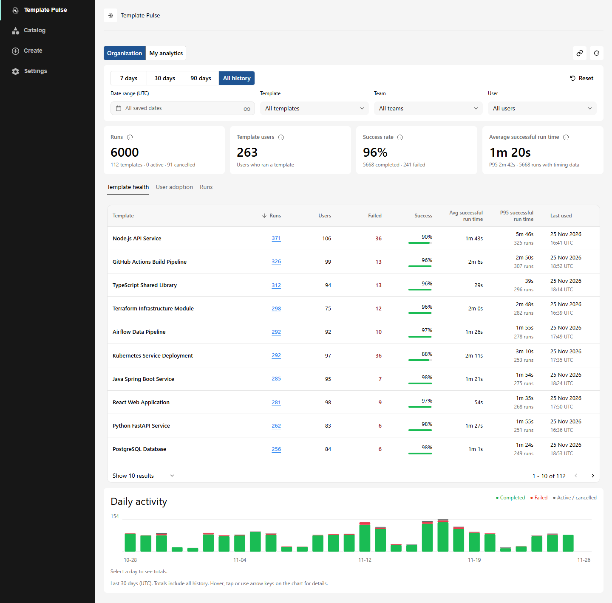
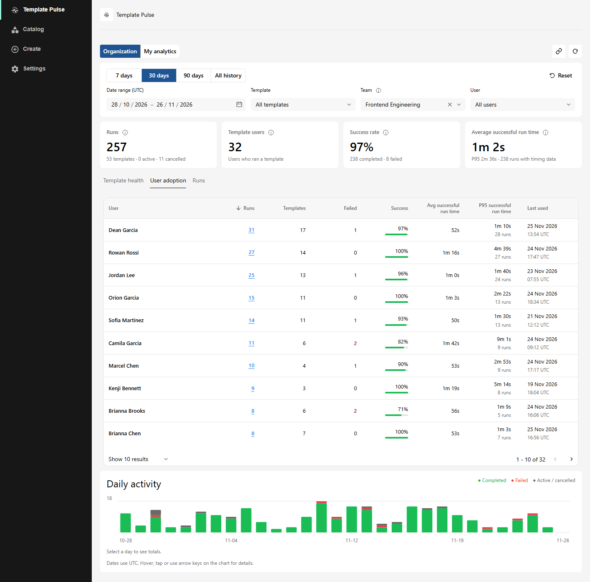
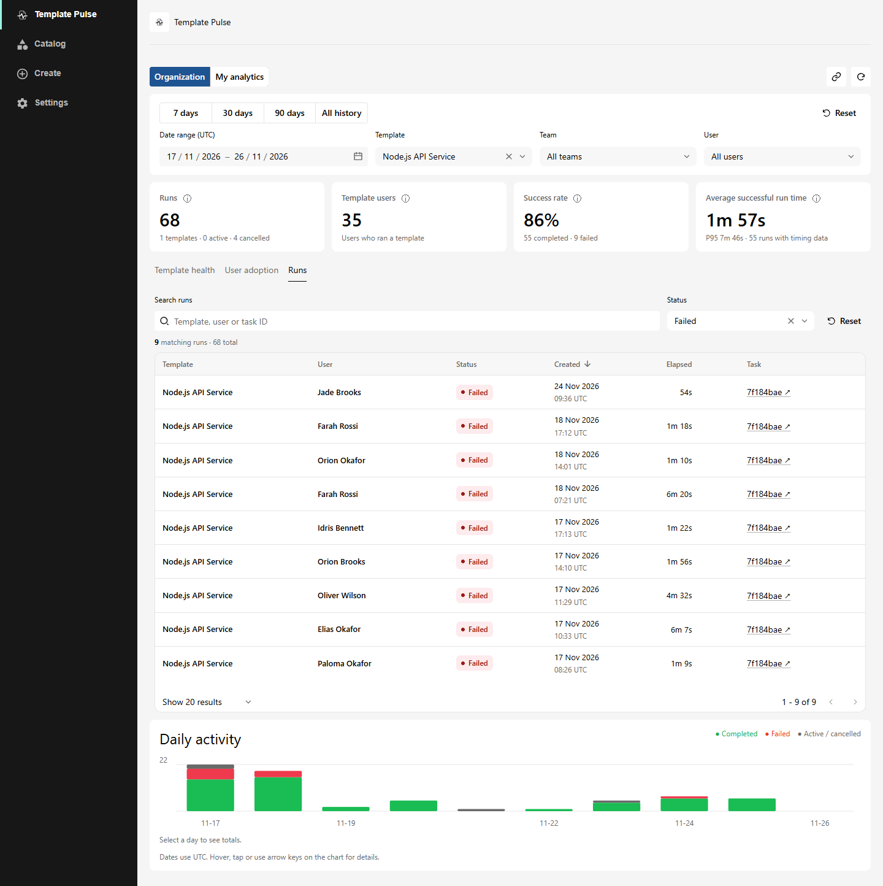
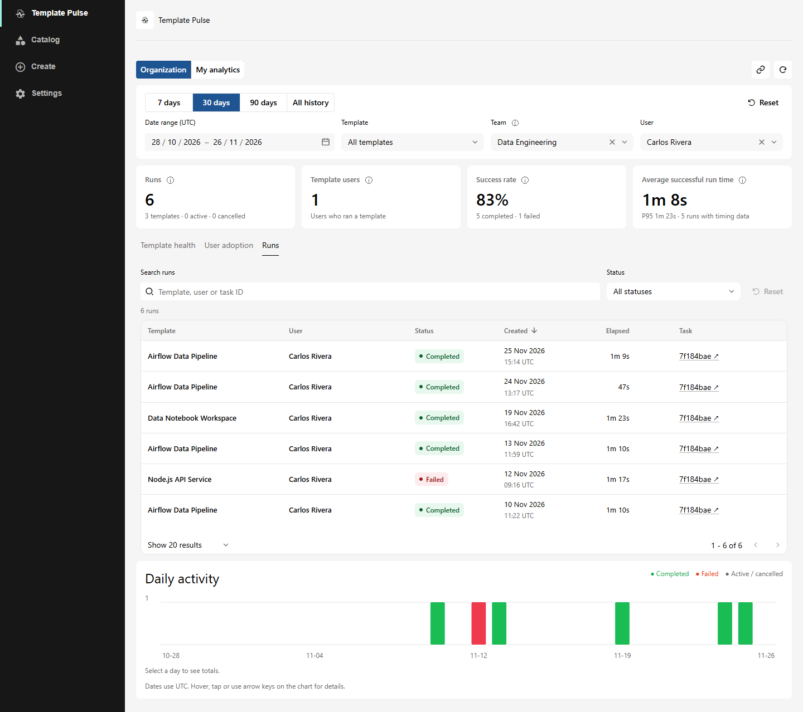

# Template Pulse

**[Try the live demo](https://alibayramli.github.io/template-pulse-demo/)** · [Run the demo locally](https://github.com/alibayramli/template-pulse-demo#run-the-showcase)

<picture>
  <source media="(prefers-color-scheme: dark)" srcset="plugins/template-pulse/assets/template-pulse-wordmark-inverse.svg">
  
</picture>

See which Backstage templates people use, how often runs succeed, and how long they take. Filter runs by date, template, user, or team, and open the Scaffolder task for details.

## Preview

Template Pulse in Backstage with sample data.



<details>
<summary>Teams and run history</summary>







</details>

## Add to Backstage

Requires Backstage's new frontend and backend, React 18, and Node.js 22 or 24. Your app must already have Scaffolder, user sign-in, and a permission backend with a registered policy.

The minimal setup uses your existing Scaffolder API and covers the latest 200 runs.

From your Backstage app's root, install the packages (adjust `app` and `backend` if your workspaces use other names):

```sh
yarn workspace app add @abayramli/backstage-plugin-template-pulse
yarn workspace backend add @abayramli/backstage-plugin-template-pulse-backend @abayramli/backstage-plugin-template-pulse-common
```

Add the plugin to your existing frontend setup (`packages/app/src/App.tsx`) and import the Backstage UI styles once:

```tsx
import '@backstage/ui/css/styles.css';
import { createApp } from '@backstage/frontend-defaults';
import templatePulse from '@abayramli/backstage-plugin-template-pulse';

createApp({ features: [/* existing features, */ templatePulse] });
```

Add the backend in `packages/backend/src/index.ts`, alongside your Scaffolder and permission backends:

```ts
backend.add(import('@abayramli/backstage-plugin-template-pulse-backend'));
```

Enable permissions in `app-config.yaml`:

```yaml
permission:
  enabled: true
```

Copy the [permission example](examples/permission-policy.ts) into your backend. In your registered policy's `handle` method, call `executionHistoryDecision(request, user)` and return its decision when defined, before your fallback. Replace `group:default/platform-admins` with your admin group.

- `template-pulse.read` lets users see their own runs.
- `template-pulse.read-all` lets users see runs across the organization.

Scaffolder task permissions also apply. An allow-all policy lets every signed-in user see runs across the organization.

Restart your app and backend, sign in, run a template, then open **/template-pulse**. Check that the run appears under **My analytics** and its task link opens in Scaffolder.

Users granted `template-pulse.read-all` can also select **Organization**. Team filters use catalog groups and their current direct members.

Search, status, and sorting change only the run list. Use **Copy link** to share your filters. Inputs, secrets, outputs, and raw logs are not shown.

For older runs and searchable filters, add the optional [database history module](plugins/scaffolder-backend-module-template-pulse/README.md). Its guide covers limits and setup for multiple backend servers.

Update all Template Pulse packages together, including the optional history module.

[Apache-2.0](LICENSE)
